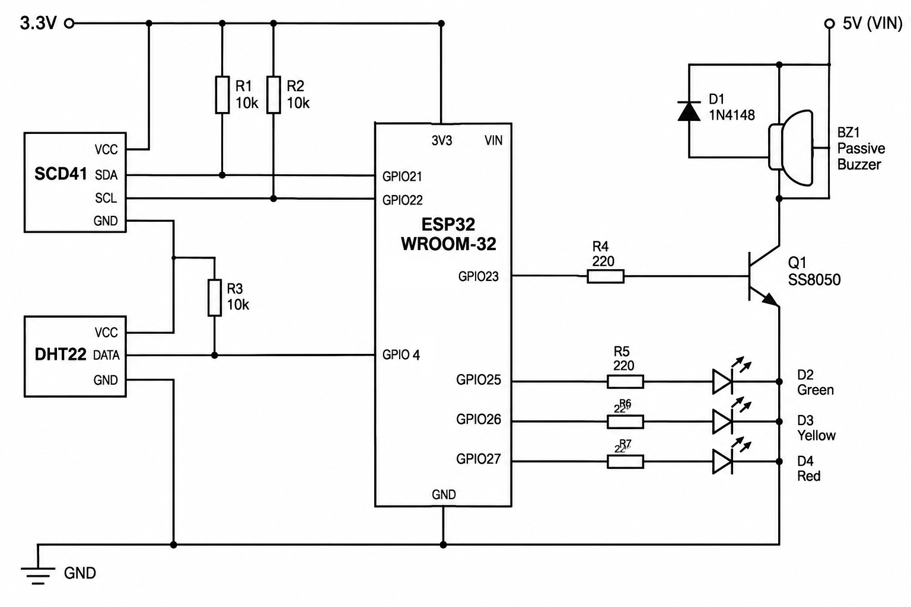

# ESP32 CO2 Monitor with Geiger Buzzer

Проект автономного модуля мониторинга параметров микроклимата (CO2, температура, влажность) с передачей телеметрии в систему мониторинга Zabbix и локальной звуковой/световой индикацией.

## Функциональные возможности

*   Измерение концентрации CO2, температуры и влажности с помощью датчика Sensirion SCD41 (NDIR).
*   Резервное измерение температуры и влажности с помощью датчика DHT22.
*   Передача данных в Zabbix Server по протоколу Zabbix Sender (TCP порт 10051).
*   Звуковая индикация уровня CO2 на базе пассивного зуммера. Частота импульсов модулируется по закону распределения Пуассона (имитация звукового сопровождения дозиметра).
*   Светодиодная индикация уровня CO2 (зеленый / желтый / красный).
*   Индикация статуса подключения к Wi-Fi.
*   Программный watchdog для контроля зависания шины I2C и датчика SCD41.
*   Режим симуляции и настройки параметров зуммера через Serial-порт.

## Аппаратное обеспечение

### Спецификация компонентов

| Компонент | Спецификация / Модель | Примечание |
| :--- | :--- | :--- |
| Микроконтроллер | ESP32 WROOM-32 | Плата разработчика с USB-UART (CH340) |
| Датчик CO2 | Sensirion SCD41 | Фотоакустический, интерфейс I2C |
| Датчик T/H | DHT22 (AM2302) | Цифровой интерфейс (1-Wire) |
| Зуммер | Пассивный электромагнитный, 12085 | 16 Ом, рабочее напряжение 3–12 В |
| Транзистор | NPN SS8050 (S8050) | Ключ для управления зуммером |
| Диод | 1N4148 | Защитный диод (flyback) для индуктивной нагрузки |
| Резисторы | 10 кОм (2 шт.) | Подтяжка шины I2C |
| Резисторы | 220 Ом (4 шт.) | Токоограничительные (база транзистора, светодиоды) |
| Светодиоды | 5 мм (Зеленый, Желтый, Красный) | Индикация уровня CO2 |

## Схема подключения (Pinout)

| Пин ESP32 | Назначение | Подключение |
| :--- | :--- | :--- |
| GPIO 21 | I2C SDA | SCD41 SDA (через подтяжку 10кОм к 3.3V) |
| GPIO 22 | I2C SCL | SCD41 SCL (через подтяжку 10кОм к 3.3V) |
| GPIO 4 | Data | DHT22 Data (подтяжка 10кОм к 3.3V) |
| GPIO 23 | Control | База транзистора SS8050 (через резистор 220 Ом) |
| GPIO 25 | Output | Зеленый светодиод (через резистор 220 Ом) |
| GPIO 26 | Output | Желтый светодиод (через резистор 220 Ом) |
| GPIO 27 | Output | Красный светодиод (через резистор 220 Ом) |
| GPIO 2 | Output | Встроенный синий светодиод (статус Wi-Fi) |

### Схема управления зуммером
Для питания зуммера используется напряжение 5V (VIN) для обеспечения достаточной громкости. Управление осуществляется по низкой стороне (low-side switch).
*   Питание зуммера (+): 5V (VIN).
*   Зуммер (-): Коллектор (C) транзистора SS8050.
*   Эмиттер (E) транзистора: GND.
*   База (B) транзистора: GPIO 23 (через резистор 220 Ом).
*   Защитный диод 1N4148: включен параллельно зуммеру (катод к 5V, анод к коллектору).

## Архитектура программного обеспечения

Проект использует операционную систему реального времени FreeRTOS (в составе ESP32 Arduino Core) для разделения задач по ядрам процессора:

*   **Ядро 1 (Core 1):** Выполнение основного цикла `loop()`. Обработка данных с датчиков (SCD41, DHT22), управление светодиодами, расчет и генерация звуковых импульсов, чтение Serial-порта.
*   **Ядро 0 (Core 0):** Выполнение задачи `zabbixTask`. Обработка стека Wi-Fi, переподключение при потере сети, отправка данных в Zabbix. Связь с ядром 1 осуществляется через очередь FreeRTOS (`QueueHandle_t`), что исключает блокировку генерации звука во время сетевых операций.

## Настройка и сборка

1.  Установите необходимые библиотеки через менеджер библиотек Arduino IDE:
    *   `SensirionI2cScd4x`
    *   `ESP32ZabbixSender`
    *   `DHT sensor library` (Adafruit)
2.  Скопируйте файл `secrets.h.example` в `secrets.h` и укажите SSID и пароль вашей Wi-Fi сети.
3.  Укажите IP-адрес сервера Zabbix в функции `zSender.Init()` в основном скетче.
4.  Выполните компиляцию и прошивку платы.

## Интерфейс отладки (Serial)

Скорость порта: 115200 бод. Поддерживаются следующие команды:
*   `<число>` (например, `1200`) — активация симуляции показаний CO2.
*   `0` — отключение симуляции и переход на данные с реального датчика.
*   `f=<число>` (например, `f=6000`) — установка частоты звукового сигнала (Гц).
*   `d=<число>` (например, `d=3`) — установка длительности импульса (мс).

## Схема электрическая принципиальная

